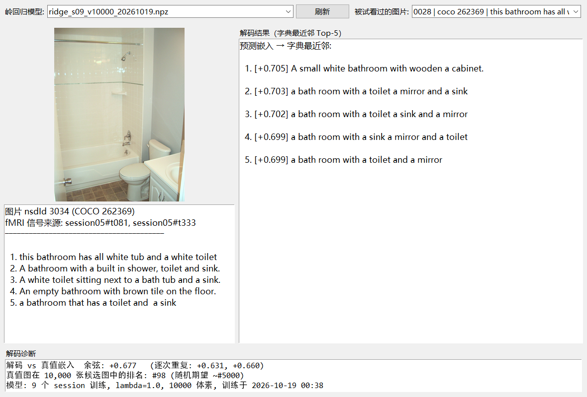

# 从 fMRI 脑活动解码视觉语义文本

> 复刻学习记录：Doerig et al., *"High-level visual representations in the human
> brain are aligned with large language models"*, **Nature Machine Intelligence
> (2025)** —— 用 LLM 句子嵌入作为中间表示，从被试观看自然图片时的 fMRI 信号
> 解码出图片描述文本。

被试看图片时，视觉皮层的活动模式包含了图片的语义内容。这个语义内容可以用文本在 LLM 嵌入空间（MPNet）中的向量来定量刻画。以嵌入向量为中间表示，即可从视觉fMRI信号解码图片语义文本：

```
fMRI 体素活动模式──▶ 岭回归──▶ 768 维 MPNet 句子嵌入向量──▶ “文本-嵌入”字典最近邻查找──▶ 图片描述文本
```

训练数据来自 [Natural Scenes Dataset (NSD)](https://naturalscenesdataset.org)：
被试 1 观看了 10,000 张 COCO 自然图片（每张 3 次，共 30,000 个 trial），
每张图有 5 条人工描述。**fMRI→嵌入**用岭回归学习，**嵌入→文本**不做生成，
而是在大规模描述语料里做最近邻查找。

## 项目管线与进度

| 阶段 | 内容 | 备注 |
|---|---|---|
| 0. 文本侧先行 | MPNet 嵌入 + 字典查找微缩演示（噪声鲁棒性扫描） | 从 COCO train2017 描述中取 5,000 张图的 25,012 条干扰句 + 1,000 张查询图的 5,000 条目标句，经 all-mpnet-base-v2 嵌入（768 维、L2 归一化），缓存于 `outputs/embed_cache_5000_1000.npz`（97MB）|
| 1. 数据准备 | NSD subj01 元数据 + betas 下载（并行断点续传） | |
| 2. 目标矩阵 | 10,000 图 × 5 描述 → Y 矩阵（10,000×768） | 每图 5 条描述嵌入取平均 |
| 3. 解码训练 | streams ROI 体素 → 嵌入的岭回归（CV 选 λ） | 9 session（~5,900 trial）× R2 前 10,000 体素，3 折 CV 选出 λ=1.0（CV cosine 0.136），测试 cosine 0.183；模型文件 `outputs/ridge_models/ridge_s09_v10000_20261019.npz`（60MB，含权重/测试 beta/真值描述/溯源） |
| 4. 交互演示 | 选图 → 载入 fMRI → 预测嵌入 → 查字典 → Top-5 文本 | |
| 5. 完整复刻 | 40 session 全量训练 + CC12M 大字典 + shared-515 测试集 |  |

## 阶段结果

### 文本侧：嵌入 + 字典查找的噪声鲁棒性（`src/step1_embedding_lookup.py`）

模拟"解码嵌入"= 目标嵌入 + 高斯噪声，在 30,012 条描述的字典里查最近邻：

| 目标余弦 | hit@1 | hit@5 | 说明 |
|---|---|---|---|
| 1.00 | 0.849 | 0.968 | 无噪声上限（受同义句干扰限制） |
| 0.80 | 0.852 | 0.960 | 几乎不衰减 |
| 0.60 | 0.824 | 0.959 | 重噪声下仍稳定命中 |

**关键发现**：MPNet 空间中"同场景描述"聚得很紧，与干扰句之间间隔很大——
这解释了为什么论文用简单字典查找（而非生成式 LLM）就足以重建描述。
定性例子：真值 *"a man walking and holding a surfboard on his head"* 在
余弦 0.6 噪声下检索回 *"A man who is carrying a surfboard over his head."*

### fMRI 解码（`src/decode_nsd.py` / `src/train_model.py`）

| 训练量 | 测试 cosine（均值） | 备注 |
|---|---|---|
| 1 session / 363 trial（冒烟） | ≈ 0.14 | 机制验证，无个体辨别力（预期内） |
| **9 session / ~5,900 trial（当前模型）** | **0.183**（中位 0.178） | λ=1.0（3 折 CV 选出），10,000 体素 |

个体差异很大：解码-真值余弦最高到 **0.68**，真值图在 10,000 张候选图中的排名
最好到 **#9**（随机期望 ~#5000）。定性例子（真实解码输出，非挑选理论值）：

| 真值描述（被试看的图） | 字典检索 Top-1 | 余弦 / 真值排名 |
|---|---|---|
| A black cat sits in a car and looks out. | there is a cat that is looking out of the window | +0.578 / **#9** |
| A husky dog has an orange frisbee in it's mouth. | A dog stands in the grass next to a stuffed bear. | +0.447 / #70 |

完整量级（论文为约 27,000 训练 trial + 分数岭回归）待 40 session 下载完成后训练。

## 交互解码程序（`src/decode_app.py`）




操作流程：
```bash
python src/decode_app.py          # 需先完成数据准备与模型训练（见下）
```


1. 下拉框选择**岭回归模型**（`outputs/ridge_models/` 下的模型包）
2. 下拉框选择**被试看过的图片**并预览（显示 cocoId 与第一条人工描述）
3. 点击 **开始解码**：程序自动载入该图片各次重复的 fMRI beta
   （并显示来源 session/trial 溯源），经岭回归预测嵌入向量，
   在字典中做最近邻查找
4. 界面展示：真值描述（左）、**匹配度最高的 5 条文本及余弦分数**（右）、
   解码诊断（预测-真值余弦、逐次重复一致性、真值图在 10,000 张候选图中的排名）


## 目录结构

```
├── README.md                  # 本文件
├── docs/DATA_STRUCTURE.md     # ★ 数据与目录结构详解（尤其 NSD fMRI 数据）
├── src/
│   ├── step1_embedding_lookup.py     # 文本侧演示：嵌入 + 字典查找 + 噪声扫描
│   ├── list_nsd_s3.py                # NSD S3 桶清单查询工具
│   ├── download_nsd.py               # NSD 并行断点续传下载器（16 连接）
│   ├── precompute_caption_embeddings.py  # Y 矩阵预计算
│   ├── decode_nsd.py                 # 解码管线（加载→对齐→岭回归→评估）
│   ├── train_model.py                # 训练并保存模型包（供交互程序使用）
│   ├── fetch_test_images.py          # 按需抽取测试图片（zip HTTP-Range 抽取）
│   ├── decode_app.py                 # ★ 交互解码程序（Tkinter，含图片展示）
│   └── watch_and_decode.py           # 看门狗：数据齐后自动全量解码
├── results/                    # 小体积结果文件（大文件见 .gitignore）
└── .gitignore
```


## 项目指南

```bash
# 环境：Python 3.10+，CPU 即可（MPNet 嵌入 4 线程约 30 条/秒）
pip install numpy requests nibabel sentence-transformers

# 1. 下载 NSD subj01 最小数据集（免 AWS 账号，S3 公开桶，约 21.6GB）
python src/download_nsd.py

# 2. 下载 COCO 描述标注（captions_train2017.json / captions_val2017.json）
#    与 MPNet 模型（sentence-transformers/all-mpnet-base-v2）并放入 data/、models/

# 3. 预计算解码目标 Y 矩阵
python src/precompute_caption_embeddings.py

# 4. 训练解码模型（用已下载的 session）
python src/train_model.py

# 5. 抽取测试图片（从 COCO zip 镜像按需 Range 抽取约 800 张，无需下整包）
python src/fetch_test_images.py

# 6. 交互解码
python src/decode_app.py
```

